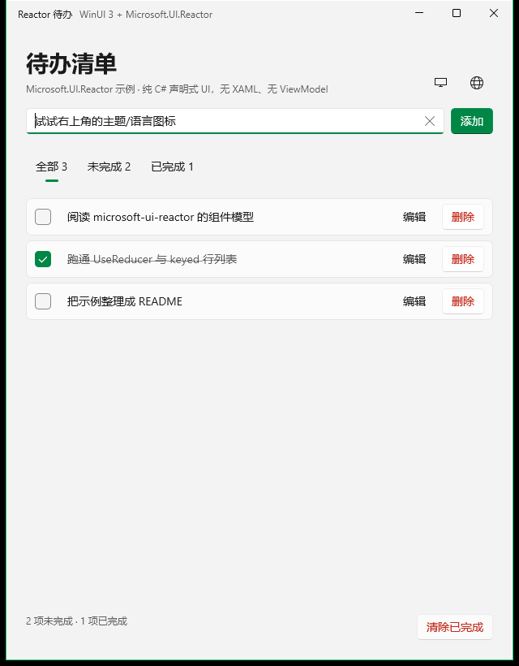
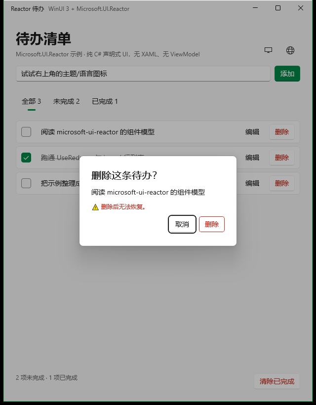

# Reactor Todo

用 [microsoft/microsoft-ui-reactor](https://github.com/microsoft/microsoft-ui-reactor) 写的 WinUI 3 待办清单示例。

Reactor 是微软实验性的 **声明式、组件化 C# UI 框架**：渲染出来的是真正的 WinUI 控件，但用 C# 工厂方法 + Hooks 描述界面，不需要 XAML、不需要 ViewModel、不需要 code-behind。本项目把它的核心用法集中在一个可以直接运行的待办应用里。



## 功能

- 新增待办：点「添加」或按 <kbd>Enter</kbd>
- 勾选完成 / 取消完成：点复选框或**直接点标题文字**都可以（已完成显示删除线与次级文字色）
- 行内重命名：点「编辑」→ 就地编辑，<kbd>Enter</kbd> 保存、<kbd>Esc</kbd> 取消
- 删除单条、一键「清除已完成」——两者都会先弹二次确认，红色危险按钮 + 后果说明
- 过滤器：全部 / 未完成 / 已完成，各自带实时计数
- 底部汇总「N 项未完成 · M 项已完成」，空列表有占位提示
- **多语言**：简体中文 / English / 日本語 / 跟随系统，切换即时生效（含窗口标题与无障碍名称）
- **设置入口**：页面右上角两个图标按钮（主题、语言）。主题是三态循环，**点一下换一个**（跟随系统 → 日间 → 夜间 → 跟随系统），图标会随当前模式变化：跟随系统 = 显示器 `\uE7F4`、日间 = 太阳 `\uE706`、夜间 = 月亮 `\uE708`；语言点开是带勾选的菜单气泡（地球 `\uE774`）。字体用系统自带的 `Segoe MDL2 Assets`（Win10 也有，`Segoe Fluent Icons` 只在 Win11）
- **主题**：浅色 / 深色 / 跟随系统，切换即时生效；「跟随系统」跟随的是系统的**深浅色**，系统切主题时应用自动跟随（不取系统的自定义强调色）
- **图标过渡**：日间↔夜间切换用 **Lottie 动画**（太阳↔月亮形变，517ms）播放；跟随系统用显示器字形
- 自动持久化：待办写入 `todos.json`，主题与语言写入 `settings.json`，重启后都恢复
- 按钮按语义分色：主操作实心强调色、普通操作默认样式、轻量操作无边框、危险操作系统红



## 环境要求

| 项 | 要求 |
|---|---|
| 系统 | Windows 10 1809（17763）及以上 |
| SDK | .NET 10 SDK（项目目标框架 `net10.0-windows10.0.26100.0`） |
| 包 | `Microsoft.UI.Reactor` **0.1.0-preview.16**（实验性预览版） |
| 运行 | 已开「开发者模式」（打包运行时 `dotnet run` 需要注册应用标识） |

## 快速开始

```powershell
# 打包项目形态，必须显式指定平台
dotnet run --project .\src\TodoApp\TodoApp.csproj -p:Platform=x64

# 或者只构建，然后直接双击 exe（已自带 Windows App SDK 运行时）
dotnet build .\src\TodoApp\TodoApp.csproj -p:Platform=x64
.\src\TodoApp\bin\x64\Debug\net10.0-windows10.0.26100.0\win-x64\TodoApp.exe
```

用 Visual Studio 打开 `ReactorTodo.slnx` 后，启动配置选「Reactor Todo (Package)」按 F5 即可；
「Reactor Todo (Unpackaged)」则是无包标识运行。

## 项目结构

```
ReactorTodo.slnx
docs/screenshot.png
tools/ui-smoke-test.ps1       # 用 UI Automation 驱动真实窗口的端到端冒烟测试
src/TodoApp/
  Program.cs                 # 入口：一行 ReactorApp.Run<App>(...)
  App.cs                     # 根组件：主题/语言偏好 + LocaleProvider
  TodoScreen.cs              # 待办界面（在 LocaleProvider 内，用 UseIntl 取文案）
  Models/TodoItem.cs         # record 数据模型
  State/TodoState.cs         # 待办状态、动作、纯函数 reducer、过滤器
  State/AppSettings.cs       # 主题/语言偏好 + 语言→locale 解析
  Storage/TodoStore.cs       # 待办 JSON 持久化
  Storage/SettingsStore.cs   # 偏好 JSON 持久化
  Localization/
    StringKeys.cs            # 文案 key 常量（写错编译期就报）
    AppStringProvider.cs     # IStringResourceProvider 实现：3 种语言 + 回退链
    IntlExtensions.cs        # intl.T(key, args) 便捷方法
  Components/
    AddTodoBar.cs            # 输入框 + Enter 提交（组件内 useState）
    TodoRow.cs               # 单行卡片：勾选、行内编辑、删除（走二次确认）
    FilterBar.cs             # SelectorBar 过滤器
    TodoCommands.cs          # dispatch 的稳定门面（UseMemo 缓存）
    Buttons.cs               # 按钮语义：主 / 普通 / 轻量 / 危险（含换色资源键）
    ConfirmDialog.cs         # 状态驱动的二次确认对话框（自绘危险色按钮）
```

整个应用只有 17 个 `.cs` 文件，**没有一个 `.xaml`**。

## 按钮语义与二次确认

### WinUI 有哪几种按钮样式

WinUI 不只是「白色底的按钮」，它内置了几套样式，Reactor 一一对应地暴露成修饰符：

| WinUI 样式 | Reactor 修饰符 | 观感 | 本项目用在哪 |
|---|---|---|---|
| `DefaultButtonStyle` | 无（默认） | 中性浅底 + 边框，随明暗主题 | 对话框里的「取消」 |
| `AccentButtonStyle` | `.AccentButton()` | 实心强调色（跟随系统强调色） | 「添加」「保存」 |
| `SubtleButtonStyle` | `.SubtleButton()` | 无边框透明，仅悬停有底色 | 「编辑」「取消」 |
| text link | `.TextLink()` | 文字链接样式 | 未使用 |

WinUI **没有**内置「危险 / 破坏性」按钮样式（`Theme.Error`、`Theme.Success` 这些 token 也不存在），
所以危险按钮是用主题 token 自己拼的，集中在 `Components/Buttons.cs`：

| 语义 | 辅助方法 | 实现 | 观感 |
|---|---|---|---|
| 主操作 | `Buttons.Primary` | `.AccentButton()` | 实心强调色 |
| 普通操作 | `Buttons.Normal` | 默认样式 | 中性浅底 |
| 轻量操作 | `Buttons.Subtle` | `.SubtleButton()` | 无边框 |
| 危险（可重复） | `Buttons.Danger` | `.SubtleButton()` + `Foreground(Theme.SystemCritical)` + 悬停/按下改 `Theme.SystemCriticalBackground` | 红字，悬停淡红底 |
| 危险（终态确认） | `Buttons.DangerOutlined` | 默认按钮形状 + 红字 + 红描边 + 悬停淡红底 | 与「取消」同形，红字红框 |

换色用的是 **lightweight styling**：按钮模板会去读 `ButtonBackground`、`ButtonBackgroundPointerOver`、
`ButtonForeground*`、`ButtonBorderBrush*` 之类的资源键，在元素上覆盖它们，悬停 / 按下 / 禁用状态会一起跟随
——既不用自定义 `Style`，也不用写 XAML。配色全部来自 `Theme.*` token，明暗主题和高对比度都能读。

### 为什么行内是红字、对话框是红字+描边

实测过四种按钮样式的真实度量（`.Set(b => b.Loaded += …)` 读 WinUI 控件本身）：
**默认 / 强调 / 轻量三种样式的几何完全一致**——圆角 `4`、内边距 `11,5,11,6`、高度 `32`。
也就是说「圆角不一样」是错觉，差异只来自填充和色重。

所以两级危险操作用同一套系统几何，只靠**颜色与描边**表达强度，而不是靠自造一个实心红块：

- 列表里的「删除」可重复、旁边还有别的条目，用**红字无底色**（最低干扰，和 WinUI 破坏性菜单项一致）；
- 对话框里的「删除」是流程终点、不可撤销，用**红字 + 红描边**。它和左边的「取消」共用默认按钮的尺寸、
  圆角与基线，所以两颗按钮读起来是“同一套系统按钮”，只是颜色不同。

（早期版本对话框用的是「实心红底白字」，靠 `AccentButtonStyle` 覆盖成红色。功能没问题，但那是自造外观，
在一对系统按钮里显得突兀，已按上面的方式改掉。）

### 踩到的样式坑：`.Foreground()` 会把圆角清零

上面那两个危险样式最初做出来是**方角**的，和旁边的系统按钮对不上。实测原因不在配色，而在
`.Foreground(...)`：Reactor 给按钮加前景色时会把它切到一个显式 `Button` 样式，而那个样式没有携带
`CornerRadius` 设置，控件的 `Button.CornerRadius` 就从默认的 `4,4,4,4` 变成 `0,0,0,0`
（`.Resources(...)` 是无辜的，单独使用仍是 4）。

```csharp
// 方角：只加前景色
Button("删除", onClick).Foreground(Theme.SystemCritical);            // CornerRadius = 0

// 修复：显式取回系统圆角（与默认按钮用的是同一个主题资源）
Button("删除", onClick)
    .Foreground(Theme.SystemCritical)
    .CornerRadius(ThemeResource.CornerRadius("ControlCornerRadius")); // CornerRadius = 4
```

修复后实测：描边在按钮顶行从 **x=3** 才开始、到中部才从 **x=0** 开始（半径 4 的圆弧），
行内悬停底色同样带圆角；padding 与高度不变（`11,5,11,6` / `32`）。

### 二次确认

删除和「清除已完成」都不再立即执行，而是走同一套**状态驱动**的确认流程：

```
点「删除」            → RequestDelete(id)   → PendingDeleteId = id     → 对话框 IsOpen = true
点「取消」/ 按 Esc     → CancelDelete       → PendingDeleteId = null   → 关闭，列表不变
点对话框里的「删除」   → ConfirmDelete      → 真正移除 + 清空 pending
```

实现要点：

- **对话框就是状态**：`TodoState` 多了 `PendingDeleteId`、`PendingClearCompleted` 两个字段；渲染、打开、
  关闭全部走 reducer，没有任何命令式的 `ShowAsync()`。
- **每条关闭路径都收敛**：`ContentDialogElement.OnClosed` 统一派发 cancel，所以 Esc、点标题栏关闭、
  按钮关闭都不会留下悬挂状态（cancel 幂等，确认后再触发一次也无害）。
- **按钮放进对话框内容里**：WinUI 的 `PrimaryButtonText` 只能传文本、样式固定，无法用危险色。所以
  `ConfirmDialog` 把「取消 / 删除」两个自绘按钮放进内容，`primaryButtonText` 传空串隐藏内置按钮。
- **无事可做时禁用而不是弹空对话框**：「清除已完成」在 `CompletedCount == 0` 时直接 `.IsEnabled(false)`。

## 多语言与主题

### 多语言

用的是 Reactor 自带的本地化栈，不是自己造的一套：

```csharp
// App.cs —— 整屏包进 LocaleProvider，语言变化会重渲染整棵树
return FlexColumn(
    LocaleProvider(
        settings.Locale,                                    // "zh-CN" / "en-US" / "ja-JP"
        Component<TodoScreen, TodoScreenProps>(new(settings, settingsCommands)),
        AppStringProvider.Instance,                         // IStringResourceProvider
        AppStringProvider.DefaultLocale));

// 任意后代组件 —— 直接取文案，不用层层传参
var intl = UseIntl();
Buttons.Primary(intl.T(StringKeys.AddButton), Submit);
Caption(intl.T(StringKeys.Summary, ("remaining", n), ("completed", m)));
```

- **回退链在 provider 里**：`LocaleProvider` 只是把请求的 locale 传下来，**不会**回退（实测未支持语言
  会拿到空串），所以 `AppStringProvider` 自己实现 `精确 locale → 语言 → 默认 → key` 四级查找。
- **文案表写在代码里**（三种语言各一份），换成 `.resw` 资源文件时实现同一个接口即可
  （Reactor 自带 `ReswResourceProvider`）。
- 连带本地化的还有**窗口标题**与**无障碍名称**（`AutomationName`），所以 UI 自动化测试要按窗口句柄找窗口。

### 主题

- `ThemeMode.System / Light / Dark` → `ElementTheme.Default / Light / Dark`，切换立即生效并写入 `settings.json`。
- 界面颜色全部走 `Theme.*` 语义 token，深浅色自动适配：同一张卡片在两种主题下实测解析为
  `#B3FFFFFF`（浅）与 `#0DFFFFFF`（深）。
- 实现上踩了两个 Reactor 的坑（见踩坑记录 13、14）：`.RequestedTheme()` 加在组件返回的根元素上不生效，
  且 `Theme.*` 画刷是**元素创建时**解析的。所以做法是——直接在控件上写 `RequestedTheme`，
  并在主题变化时用 `.WithKey($"theme-{theme}")` 让整棵子树重建。
- **背景必须自己铺**：`BackdropKind.Mica` 跟随的是**系统**主题，不会跟着应用内的 `RequestedTheme` 走。
  只切内容主题会出现「白底 + 白字」。所以现在**始终**在根元素铺一层 `Theme.SolidBackground`
  （实测深色下为 `#FF202020`、文字 `#FFFFFFFF`；浅色下 `#FFF3F3F3` + `#E4000000`），不再依赖 Mica。
- **「跟随系统」= 跟随深浅色**：启动时用 `UISettings.GetColorValue(UIColorType.Background)` 判断系统是深还是浅，
  再订阅 `UISettings.ColorValuesChanged`（回调在后台线程，需 `DispatcherQueue.TryEnqueue` 回到 UI 线程）
  解析成具体的 Light / Dark 再套用。这样既不会取系统的自定义强调色，系统切主题时应用也会自动跟随。
- **为什么不用 `AnimatedIcon`**：WinUI 的 `AnimatedIcon` 必须提供一个 `IAnimatedVisualSource`（Lottie 动画）。
  系统自带的动画面板只有设置/查找/返回/汉堡/箭头等，没有太阳/月亮/显示器这类主题图标；自绘 Lottie 再跑 LottieGen
  成本过高，所以改用 WinUI 原生 Storyboard：在 `.OnMount` 里给图标播放 140ms 的淡入。
- **日间/夜间用 Lottie 动画**：`Assets/lottie/sun-moon.json`（Lottie 5.6.9，500×500，60fps，31 帧，517ms，
  **MIT © Samuel Osborne**，见 `THIRD-PARTY-NOTICES.md`）用 **LottieGen** 编译成 C#
  `IAnimatedVisualSource`（`src/TodoApp/Animations/Sun_moon.cs`，46KB），再用 `AnimatedVisualPlayer` 播放：
  日间冻结在第 0 帧（太阳）、夜间冻结在第 1 帧（月亮），切换时 `PlayAsync(from, to)` 播放形变。
  「跟随系统」仍用显示器字形，因为这个素材只覆盖太阳↔月亮。
  素材自带颜色（单色黑），所以生成时加了 **`-GenerateColorBindings`**，LottieGen 会暴露两个可改的颜色属性：
  `Color_000000`（图形本体）。夜间换成白色、白天换成近黑，保证两种主题下都清晰。
  **颜色必须在把 source 交给 `AnimatedVisualPlayer.Source` 之前设置**——动画视觉是从 source 构建的。
  实测：`IsAnimatedVisualLoaded=True`、`Duration=517ms`、切换时 `played from=0 to=1 error=none`；
  反射读回 source 的颜色：浅色 `fg=#E5000000 / bg=#00FFFFFF`、深色 `fg=#FFFFFFFF / bg=#FF202020`。
- **三段式用一个素材**：市面没有现成的三态 Lottie（主流都是太阳↔月亮），所以按
  [motion-design](https://skills.sh/lottiefiles/motion-design-skill/motion-design) 与
  [text-to-lottie](https://skills.sh/diffusionstudio/lottie/text-to-lottie) 两个 Agent Skill 的规范
  **自己生成**了 `Assets/lottie/theme-3state.json`（生成脚本 [`tools/gen-theme-lottie.mjs`](tools/gen-theme-lottie.mjs)）：
  - 时间线 fr 60、帧 0–45（750 ms，每条腿 250 ms），**三段顺序正向**：`0→1/3` 系统→日间、`1/3→2/3` 日间→夜间、`2/3→1` 夜间→系统（`PlayAsync` 不支持倒放，只能正向排布）
  - Corporate 人格：`cubic-bezier(0.2, 0, 0, 1)`；切换是**左升右落**的日出/日落轨迹——新图标从左下沿弧线升到中心，旧图标从中心落到右下淡出，出入错峰 9 帧避免重叠；
    环境动效主动省略（20px 控件加了只会变噪音）
  - 结构遵守 text-to-lottie 的规则：顶层 `v/fr/ip/op/w/h/nm/assets/layers`、`op` 独占、
    **一个形状一个组**（同一组放多个形状会触发 LottieGen `LT0027` 并丢形状）、`markers` 标注三态
  - 生成脚本自带不变量自检：frame 0/15/30/45 的三层可见性、当前态必须居中、雨出方向必须左→右、出入错峰、弯月 `max x < 15`（整圆会到 21）
  - 右侧两个图标按钮按下缩到 0.92、松开回 1.0（合成器 `Visual.Scale`，不用 RenderTransform 以免字形发糊）
  - 图标视觉尺寸与旁边字体图标对齐：统一 20×20 图标盒 + 画布内图形放大 145% + 描边 7 单位（实测两侧墨迹 17×16 vs 16×16），见 [`docs/motion-spec.md`](docs/motion-spec.md) 第 8 节
  - 动效决策与两个已修复 bug 的说明见 [`docs/motion-spec.md`](docs/motion-spec.md)
  实测日志：三条腿全部正向播放，`error=none`；夜间→系统播到进度 1（第 45 帧 = 显示器）
- **为什么不是字体缩放淡入**：`ScaleTransform` 会让字形按 0.6→1 的分数比例重新栅格化，必然发糊——这也是换成
  Lottie 的直接原因（矢量动画在合成器里缩放不会出现字体那种重采样）。
- 标题栏的最小化/最大化/关闭按钮由系统绘制、跟随**应用**主题（WinUI 不支持运行时改），所以按解析后的主题
  通过 `AppWindow.TitleBar` 显式设置这几颗按钮的前景/悬停/按下色，避免出现「深色内容 + 系统绿色按钮」这种混搭。

## 代码导读：React 心智模型 → Reactor 写法

| React | 本项目中的 Reactor 写法 |
|---|---|
| `function App()` | `class App : Component { override Element Render() }` |
| `useState` | `var (draft, setDraft) = UseState("")` |
| `useReducer` | `UseReducer<TodoState, TodoAction>(TodoState.Reduce, TodoState.Initial)` |
| `useEffect` | `UseEffect(() => TodoStore.Save(state.Items), state.Items)` |
| `useMemo` | `UseMemo(() => new TodoCommands(dispatch), dispatch)` |
| `key={id}` | `Component<TodoRow, TodoRowProps>(props).WithKey(item.Id)` |
| `children` | 工厂方法的可变参数，`null` 子元素会被自动过滤 |
| `className` / `style` | `.Padding()` `.Background(Theme.CardBackground)` `.Flex(grow: 1, basis: 0)` 等流式修饰符 |

几个值得留意的实现点：

- **单一 reducer**：`TodoState` 是 `record`，所有变更都通过 `with` 产生新实例；列表相关的状态用 `UseReducer` 而不是 `UseState`（后者对 `List<T>.Add()` 不会触发重渲染，因为引用没变）。
- **稳定命令门面**：`TodoCommands` 把 `dispatch` 包成方法集合，并用 `UseMemo` 持有同一实例，于是行组件的 props 保持结构相等，未变化的行会被跳过渲染。
- **行内状态归属行自己**：「是否处于编辑态」「正在编辑的草稿」放在 `TodoRow` 内部，父组件完全不需要知道；因为行带 key，插入/删除时编辑态会跟着对应的待办走。
- **点文字也能切换完成**：标题外再包一层透明 `Border` 作为命中区——`TextBlock` 只在字形上响应指针，加透明背景后整列都可点；同时补 `.IsTabStop(true)` 与 Enter/Space 处理，键盘和读屏用户也能触发（Reactor 分析器 `REACTOR_A11Y_004` 会强制这一点）。编辑态不挂这个处理，否则点输入框就会误切换。
- **持久化**：启动时 `TodoState.Initial` 同步读盘，之后每次列表变化由 `UseEffect` 写盘；JSON 用 `JsonSerializerContext` 源生成，避免裁剪告警。
- **主题**：全部颜色走 `Theme.*` 语义 token（`Theme.CardBackground`、`Theme.SecondaryText`、`Theme.SystemSuccess` 等），窗口底色用 `Theme.SolidBackground` 自铺，因此明暗主题自动适配。

## 实测踩坑记录

以下都是在本机（Reactor 0.1.0-preview.16 + .NET 10）真实编译/运行验证出来的：

1. **FlexPanel 不能嵌套 FlexPanel**：`FlexRow` 里再放一个 `FlexRow` 会让内层塌陷成 0 尺寸，外层兄弟元素（复选框、标题）跟着不参与布局 —— 表现为行看起来是空的。改用 `HStack`（StackPanel）作为按钮组即可。这条用单独的最小复现工程逐项对比确认过。
2. **`UseState` + `List<T>.Add()` 不会重渲染**，列表状态必须用 `UseReducer`。
3. **`CheckBox` 的回调参数名是 `onIsCheckedChanged`**（不是文档散文中写的 `onChanged`），用位置参数最保险。
4. **按钮点击是构造参数**：`Button("添加", onClick)`，不存在 `.OnClick()` 修饰符。
5. **`.Padding()` 对 Flex 容器无效**（`FlexRow`/`FlexColumn` 要用 `.FlexPadding()`）；分析器会给出 `REACTOR_MOD_003` 提示。
6. **入口文件不能同时有顶层语句和 file-scoped namespace**，所以入口单独放在 `Program.cs`。
7. Reactor 自带分析器很严格：`REACTOR_HOOKS_011`（受控控件的回调忽略了新值）、`REACTOR_A11Y_003`（表单控件缺少可读名称）都会报出来 —— 本项目已按提示全部修掉，构建 0 警告。
8. **WinUI 的 `CheckBox` 样式自带 120px 的 `MinWidth`**：复选框本身只有 20px 左右，剩下全是一段空白，行会被撑得很松 —— 加 `.MinWidth(0)` 收掉。
9. **行内文本的垂直居中不能只靠 flex 拉伸**：`.Flex(grow: 1)` 会把文本框拉满行高，而文字在框内是顶端对齐的；要让文字自身高度居中，得再给 `.Flex(..., alignSelf: FlexAlign.Center)`。
10. **同名资源键只对同一套样式生效**：`AccentButtonStyle` 读的是 `AccentButtonBackground` / `AccentButtonForeground`，覆盖通用的 `ButtonBackground*` 对它完全无效；反过来默认按钮才用 `ButtonBackground*`。想改哪种样式的颜色，先确认它模板里读的是哪一组键。
11. **`ContentDialog` 的 `primaryButtonText` 传空串才会隐藏内置主按钮**；此时把自绘按钮放进 `Content` 才能完全控制样式与顺序。
12. **`.Foreground()` 会让按钮丢失圆角**：加前景色后 `Button.CornerRadius` 从 `4,4,4,4` 变成 `0,0,0,0`（样式被切成显式 `Button`，而它不设圆角）。要保留系统观感就显式补 `.CornerRadius(ThemeResource.CornerRadius("ControlCornerRadius"))`。
13. **`.RequestedTheme()` 加在组件 `Render()` 返回的根元素上不会被应用**（实测控件仍是 `Default`）。要在 `.Set(panel => panel.RequestedTheme = theme)` 里直接写属性。
14. **`Theme.*` 画刷在元素创建时解析**，所以仅改主题不会让已建好的元素换色；主题变化时要让子树重建（本项目用 `.WithKey($"theme-{theme}")`）。
15. **`ComboBox` 会回调 `SelectedIndexChanged(-1)`**（关闭下拉/反选时）。直接 `(ThemeMode)index` 会得到越界枚举并写进设置文件（`"theme": "-1"`）——要过滤 `index >= 0`，读取时再用 `Enum.IsDefined` 兜底。（早期版本用 ComboBox 时踩到；现在换成图标按钮 + 菜单气泡。）
18. **图标字体要挑系统真有的**：`Segoe Fluent Icons` 只有 Windows 11 自带，在 Windows 10 上写它会渲染成空白。跨版本请用 `Segoe MDL2 Assets`（Win10 起就有，`\uE706` 亮度、`\uE774` 地球都一样）。
19. **`RadioMenuFlyoutItem` 在 UI Automation 里是 Toggle 模式**（不是 SelectionItem/Invoke），自动化测试要用 `TogglePattern.Toggle()` 选中、`ToggleState == On` 判断勾选。
20. **`BackdropKind.Mica` 只跟系统主题走**：应用内切深色时它不会变，于是出现「白底白字」；而且它也不适合承载“跟随系统”的语义（Mica 会取系统材质/色调）。本项目改为始终自铺 `Theme.SolidBackground`。
21. **主题变化会重挂载界面，缓存下来的 AutomationElement 会失效**：自动化测试里每次点击前都要重新查找控件，否则拿旧引用点击会落到已经销毁的控件上。
22. **`.WithTransitions(...)` 在本版本没有落到控件上**（实测 `Button.Transitions.Count` 和 `Border.Transitions.Count` 都是 0），文档里的 `Transition.Fade` 也不能转换成 WinUI 的 `Transition` 类型。要真实的进入动画，用 `.OnMount(element => storyboard.Begin())` 自己播 Storyboard。
23. **给单个子元素换 `.WithKey(...)` 不会重建控件**（UIA RuntimeId 不变）；要重挂载，key 得加在**组件**元素上（本项目把屏幕按所选模式 key）。
24. **`Microsoft.Toolkit.Uwp.UI.Lottie`（Lottie-Windows 7.x）只面向 UAP**（nuspec 里是 `uap10.0.16299` + `Win2D.uwp`），WinUI 3 用不了。WinUI 3 的正确路径是 **LottieGen 生成源码**再编进项目。
25. **LottieGen 必须显式指定 `-WinUIVersion 3.0`**：默认生成的是 `Windows.UI.Composition` 版本，`RootVisual` 类型不匹配，编译报 `CS0738`。加 `-WinUIVersion 3.0` 才会生成 `Microsoft.UI.Composition` 版本。
26. **生成代码还需要 Win2D**：`Microsoft.Graphics.Canvas.Geometry` 来自 `Microsoft.Graphics.Win2D`，版本要 ≥ `1.4.0`（Reactor.Devtools 已传递引用 1.4.0，显式写 1.3.2 会触发 NU1605 降级错误）。
27. **Lottie 的颜色是烘焙进素材的**：黑色图标在深色主题下必然看不清。生成时加 `-GenerateColorBindings`，用 `SetColorProperty("Color_000000", …)` 改色；调用顺序要在 `player.Source = …` **之前**，否则视觉已经构建完毕、改色无效。
16. **`LocaleProvider` 不做语言回退**：未支持的 locale 会原样问 provider，回退逻辑得自己写在 `IStringResourceProvider.GetString` 里。
17. **在根组件外面多包一层布局容器会切断高度链**：主题改造时我一度把整屏包进 `FlexColumn(content)`，结果窗口内容变成“内容高度”，`Flex(grow: 1)` 全部失效——列表只拿到 150px（正好装下 3 行），底部留出大片空白。正确做法是不包容器，改用 `.WithKey(theme)` 让组件重挂载来刷新主题。

## 已验证内容

- `dotnet build -p:Platform=x64`（Debug / Release）：0 错误；Debug 0 警告
- `dotnet run --project src/TodoApp -p:Platform=x64`：能正常带包标识启动
- 布局几何校验：三行等距排列、按钮右对齐、页脚不被裁切
- 按钮配色（窗口逐像素采样）：主按钮实心强调色、行内删除为红字、悬停变淡红底（86% 像素）
- 按钮度量（读取真实 WinUI 控件）：默认 / 强调 / 轻量 / 危险四种样式的圆角、内边距、高度完全一致
- 对话框确认键：透明填充（白色 77%）、红字 20%、红描边 51%，与「取消」按钮尺寸和基线完全相同
- 圆角（逐像素量描边起始位置）：危险按钮顶行描边从 x=3 开始、中部从 x=0 开始 → 半径 4 的圆角生效
- 主题（读真实控件）：同一张待办卡片在浅色下解析 `#B3FFFFFF`、深色下 `#0DFFFFFF`；切换后重新加载的主题为 `actual=Dark`
- 布局（UIA 几何）：列表视口 458px 高并占满中部，汇总/清除按钮距窗口底边 32px；20 条数据时 11 条被裁在滚动区内，滚动到 100% 后最后一条可见
- 图标动画（读控件属性）：`AnimatedVisualPlayer.IsAnimatedVisualLoaded=True`、`Duration=517ms`，Light→Dark 时 `played from=0 to=1 error=none`；Lottie 颜色随主题切换（反射读回：浅色 `#E5000000`/透明、深色 `#FFFFFFFF`/`#FF202020`）
- 深色可读性（读真实画刷）：深色下根背景 `#FF202020` + 标题文字 `#FFFFFFFF`，浅色下 `#FFF3F3F3` + `#E4000000`；「跟随系统」在系统为浅色时解析为 `resolved=Light` + `#FFF3F3F3`
- 语言（UIA 读控件名）：切到 English 后按钮变为 `Add / Edit / Delete`、标题变为 `Todo list`；切到日本語为 `追加 / 削除`、`やることリスト`

项目自带一个端到端冒烟测试，用 UI Automation 驱动真实窗口（WinUI 没有无头宿主，只能跑真窗口）。
它会先备份、测完再还原你自己的 `todos.json`，不会污染数据：

```powershell
pwsh -File .\tools\ui-smoke-test.ps1     # arm64: -Arch arm64
```

覆盖 44 项检查：空列表启动、按钮新增、三个过滤器、行内重命名、行布局几何、
删除/清除的二次确认（开框、取消、确认三条路径各自校验）、按钮禁用态、重启后数据恢复、
点击标题切换完成状态（真鼠标点击）、键盘 Enter 新增、语言切换（中日英来回切）、主题切换与持久化（图标按钮 + 菜单气泡）、列表占满中部且页脚贴底。
本机实测 **44/44 全部通过**。

> 键盘输入（Enter 提交）需要窗口真正拿到前台焦点。若 Windows 拒绝把前台交给后台进程，
> 该项会明确输出 `[SKIP]` 而不是伪装成通过或失败 —— 其余 UIA 检查照常运行。

> 一个测试环境的坑：WinUI 的悬停态只认真实输入，直接改 `Cursor.Position` 不会触发指针事件，
> 需要 `mouse_event` 注入一次位移才能验证 hover 配色。

> Release 构建会出现 2 条 `IL2104` 裁剪告警，来自 Windows SDK 的 `Microsoft.Windows.SDK.NET` / `WinRT.Runtime` 程序集，与项目代码无关。

## 说明

- 本项目由 `dotnet new reactor` 官方模板脚手架改造而来（模板包 `Microsoft.WindowsAppSDK.WinUI.CSharp.Templates`），并补了 `WindowsAppSDKSelfContained=true`，这样直接双击 exe 也能跑，不必先安装 Windows App Runtime。
- Reactor 目前是**实验性预览**，API 可能随版本变化。包内自带一份面向 AI 助手的完整文档：`~/.nuget/packages/microsoft.ui.reactor/0.1.0-preview.16/agentkit/`（含 `reactor.api.txt` 全量 API 索引与 recipes），排查 API 时比翻网页快得多。
- 官方仓库：<https://github.com/microsoft/microsoft-ui-reactor>


